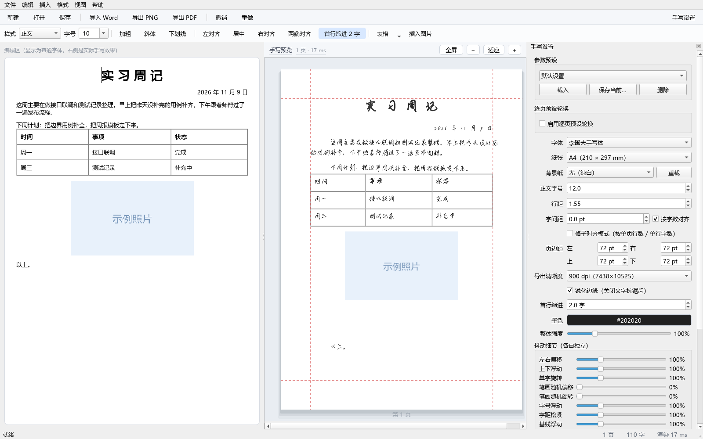
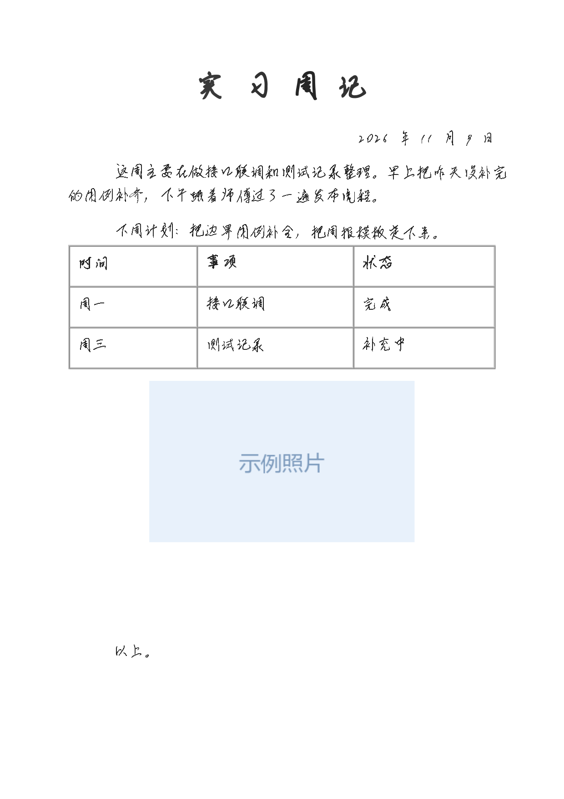

# HandWriteStudio

把文本排成「像手写作业/笔记」的页面图片或 PDF。左边用普通字体编辑排版，右边实时预览真实手写效果。

当前版本：0.4.23

> 许可证：[PolyForm Noncommercial 1.0.0](LICENSE)。免费自用、可随意修改和分享，禁止任何商业用途。严禁倒卖，请勿花钱购买盗版。

## 界面与效果

<p align="center">
  
</p>

<p align="center">
  
</p>

左边用普通字体编辑排版，右边实时预览；表格、图片、逐页预设都在同一份文档里。

## 运行

源码方式：

```bat
python -m venv .venv
.venv\Scripts\pip install -r requirements.txt
.venv\Scripts\python run.py
```

打包版：运行 `dist\HandWriteStudio\HandWriteStudio.exe`。

## 功能

- 富文本编辑：正文、标题、字号、加粗、斜体、下划线、对齐、首行缩进、字间距。
- 粘贴清理：从网页/VS Code 粘贴时去掉深色背景和花哨字体，保留段落、换行、加粗等结构。
- 实时分页预览：改字体、字号、行距、页边距后自动重排；支持 A4/B5/A5/Letter。
- 页边距预览：页面上显示四条红色虚线，可直接拖动，和右侧数值双向联动。
- 全屏预览：预览栏「全屏」，滚轮滚动，Ctrl+滚轮缩放，Esc 退出。
- 手写字效：多种手写字体、纸张背景、正文大小、行距、字间距、页边距、墨色、随机种子。
- 抖动细节：整体强度，以及左右偏移/上下浮动/单字旋转/笔画随机偏移/笔画随机旋转/字号浮动/字距松紧/基线浮动/整行倾斜/墨色浓淡等独立调节。
- 格子对齐：可切到「单页行数 / 单行字数」，让每个字钉在格心；可选按字数硬断行，或只固定纵向行数、横向自然换行。
- 逐页预设轮换：为第 1、2、3… 页分别指定预设，超出列表后从头循环；每页字体、字号、行距、行列、字距、页边距、背景可独立。
- 表格：插入表格；右键增删行列、删除表格、调整整体位置和宽度；拖动内部列边框改列宽，拖动外边缘调宽度，拖动行底边改行高。
- 图片：工具栏插入、直接粘贴、把图片文件拖进编辑区；点选后拖四角手柄缩放、拖图身移动，右键修改大小、裁剪、恢复原始大小、调位置、删除。
- 导入 Word `.docx`：正文、标题、表格、内嵌图片；复杂版式可能还原不全。
- 项目保存 `.hws`：正文 HTML + 手写参数。
- 导出：每页一张 PNG（默认 900dpi），或整份 PDF（矢量）。
- 背景纸：支持纯色、横线、格子纸；背景纸下拉可打开文件夹、重载，文件夹变化自动刷新。
- 参数预设：把当前整套参数保存为命名预设，随时载入或删除；预设存在用户配置目录，升级不丢。
- 边缘锐化：默认开启，让笔画边缘更硬；设置里可关掉换回平滑抗锯齿。

## 目录

```text
app/            程序代码
  main.py       入口
  mainwindow.py 主窗口、菜单、设置面板
  editor.py     编辑区（富文本/表格/图片）
  image_tools.py 图片尺寸、裁剪对话框
  preview.py    右侧分页预览
  renderer.py   手写渲染核心
  glyph_parts.py 字形连通墨块拆分（handright 同思路）
  strokes.py    笔画路径变形
  docx_import.py Word 导入
  project.py    .hws 项目读写
  presets.py    参数预设读写
  export.py     PNG / PDF 导出
  settings.py   参数数据模型
assets/papers/  背景纸
tests/          离屏渲染、UI、导入导出测试脚本
```

## 重新打包

```bat
.venv\Scripts\pyinstaller.exe --noconfirm --clean HandWriteStudio.spec
```

生成在 `dist\HandWriteStudio\`，整个文件夹一起拷贝，运行里面的 `HandWriteStudio.exe`。

## 说明

- 编辑区显示普通字体是为了方便改字；右边预览才是最终手写效果。
- 导入 Word 时，浮动图片、文本框、分栏、页眉页脚不会完整还原；表格和内嵌图片一般没问题。
- 背景纸是整张图片铺满，不会自动对齐纸上的横线；用带横线的纸时，行距要自己调到和横线接近。
- 字体：仓库附带可再分发的四款字体（演示悠然小楷、寒蝉手拙体、钟齐志莽行书、霞鹜文楷）；李国夫手写体等授权不允许公开分发的字体未上传，需要时请自行放入 `assets/fonts/`，或从发布包获取。商用请自行确认字体授权。
- 许可证只覆盖本仓库的代码与自带素材；仓库内字体的授权以各自字体许可证为准，不在 PolyForm 许可证范围内。
- 笔画随机偏移/旋转采用 handright 的思路：先把字形栅格化，再用 4 邻域找出连通的墨块，每块整体平移/旋转；因此连笔字只按“连通墨块”动，不是严格的语义笔画，但不会把笔画拉扭。
